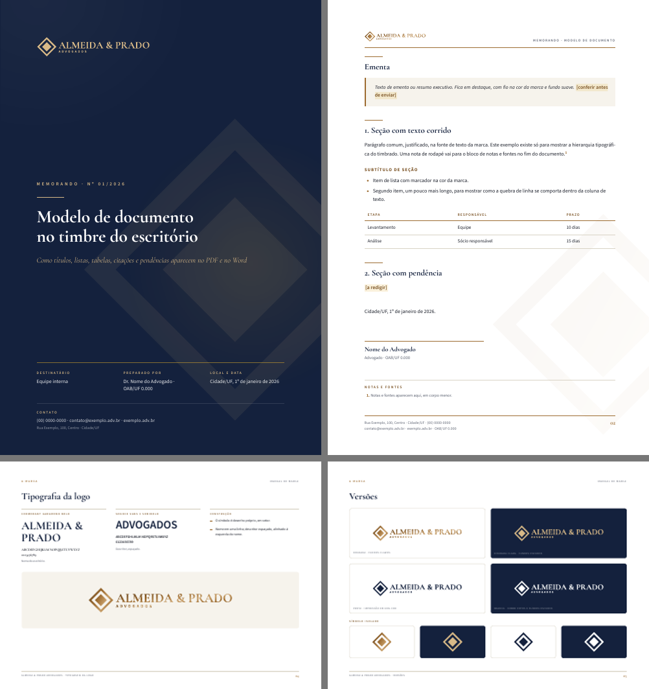

# papel-timbrado

Skill do Claude Code que transforma a marca de um escritório (advocacia, contabilidade, consultoria) em papel timbrado de verdade: logo refeita em vetor, modelo Word com cabeçalho, rodapé, estilos e fontes embutidas, PDF de apresentação com capa e manual de marca. Feita para entregar documentos na identidade visual de um parceiro em modelo white label, com uma trava que impede o nome de quem executa de vazar no arquivo.

```
site do escritório ──► extrair_marca.py ──► brand.json (você confirma)
logo raster ──► upscale ──► mascara_logo.py ──► vetorização ──┐
fonte equivalente ──► baixar_fontes.py ───────────────────────┴► logo_svg.py ──► logo SVG/PNG
brand.json ──► gerar_docx.py ──► Timbrado.docx  (o advogado escreve aqui)
brand.json + .md/.docx ──► gerar_pdf.py ──► PDF com capa  (vai para o cliente)
brand.json (bloco manual) ──► gerar_manual.py ──► Manual de Marca.pdf
tudo ──► checar_white_label.py ──► ok para enviar
```



## Instalação

```bash
git clone git@github.com:gouveaero/papel-timbrado.git ~/.claude/skills/papel-timbrado
pip install fonttools python-docx pillow numpy scipy playwright
python -m playwright install chromium
brew install pandoc harfbuzz poppler
```

Nenhuma credencial mora neste repo. A vetorização do símbolo usa o MCP do Magnific, quando disponível; qualquer traçador que gere SVG serve.

## Uso

Teste de ponta a ponta com o escritório fictício:

```bash
cd ~/.claude/skills/papel-timbrado
E=exemplos/escritorio-ficticio
python3 scripts/baixar_fontes.py $E/fonts "Cormorant Garamond:600,700,400i" "Source Sans 3:400,600,700,400i"
python3 scripts/logo_svg.py $E/logo-spec.json $E/logo
python3 scripts/gerar_docx.py $E/brand.json $E/saida/timbrado.docx
python3 scripts/gerar_docx.py $E/brand.json $E/saida/exemplo.docx --conteudo $E/conteudo.md
python3 scripts/gerar_pdf.py  $E/brand.json $E/conteudo.md $E/saida/exemplo.pdf
python3 scripts/gerar_manual.py $E/brand.json $E/saida/manual.pdf
python3 scripts/checar_white_label.py $E/saida/* --proibir "nome da sua empresa"
```

Para um escritório real, o passo a passo completo (levantamento pelo site, logo, aprovação) está no [SKILL.md](SKILL.md).

## O que tem aqui

| Arquivo | Função |
|---|---|
| `scripts/extrair_marca.py` | lê o site (inclusive SPA) e gera um brand.json de rascunho com cores, fontes, contatos e logos candidatas |
| `scripts/mascara_logo.py` | limpa logo com textura, brilho ou relevo para virar máscara vetorizável |
| `scripts/logo_svg.py` | monta símbolo + texto em curvas com kerning real (HarfBuzz) em várias cores |
| `scripts/baixar_fontes.py` | baixa do Google Fonts e gera TTFs estáticos com nomes que o Word entende |
| `scripts/gerar_docx.py` | timbrado Word; com `--conteudo`, converte Markdown em documento pronto |
| `scripts/gerar_pdf.py` | PDF com capa e timbre em todas as páginas, a partir de .md ou .docx |
| `scripts/gerar_manual.py` | manual de marca em PDF: nota sobre a logo, escritório, versões, proteção, cores, tipografia, aplicações, usos incorretos, presença digital |
| `scripts/previa_docx.py` | prévia do .docx em PNG, sem precisar de Word |
| `scripts/checar_white_label.py` | procura termos proibidos e caminhos locais no texto, no XML e nos metadados |
| `assets/documento.html` | modelo do PDF |
| `assets/manual.html` | modelo do manual de marca |
| `references/` | logo em vetor passo a passo e referência dos JSON |
| `exemplos/escritorio-ficticio/` | marca inventada para teste |

## Decisões e erros que o código já evita

- **Fontes embutidas no .docx** (subset latino, ofuscadas no padrão ECMA-376). Sem isso o timbre vira Calibri no computador de quem não tem a fonte instalada.
- **Estilos vinculados removidos.** O modelo padrão do python-docx traz "Heading 1 Char", "Title Char" com fonte e cor do tema; Google Docs e outros leitores aplicam isso por cima e o título sai azul em Times.
- **Sem marca d'água no Word por padrão.** Imagem flutuante atrás do texto em cabeçalho muda de lugar entre Word, Google Docs e WPS. O PDF leva a marca d'água.
- **Metadados limpos.** Autor, empresa e título do .docx passam a ser do escritório; some a miniatura genérica e a descrição "generated by python-docx".
- **Cabeçalho e rodapé do PDF por `@page`** (margin boxes do Chromium 131+), com fundo de página para fios e marca d'água e página nomeada para a capa sangrada.
- **Dados de exemplo em sites prontos.** Sites de template trazem endereço e telefone fictícios esquecidos no código; o extrator lista tudo para conferência em vez de escolher sozinho.
- **Logo raster não vai direto para o vetorizador.** Símbolo e texto são tratados separadamente; texto é recomposto com a fonte equivalente.

## Licença

MIT. As fontes baixadas mantêm suas próprias licenças (OFL/Apache), gravadas ao lado de cada uma.
